[lab1_report.md](https://github.com/user-attachments/files/34489002/lab1_report.md)
# Лабораторная работа №1. Обзор Google Cloud и исследование основных сервисов

## Цель работы

Ознакомиться с сервисами Google Cloud: IAM, Compute Engine и Cloud Storage.

## Ход работы

### 1. Создание сервисного аккаунта

В проекте `cloud-platforms-as-the-basis` через IAM & Admin → Service Accounts создан сервисный аккаунт `apushnaya-sa-lab1`. При создании ему назначена роль `Storage Admin`.

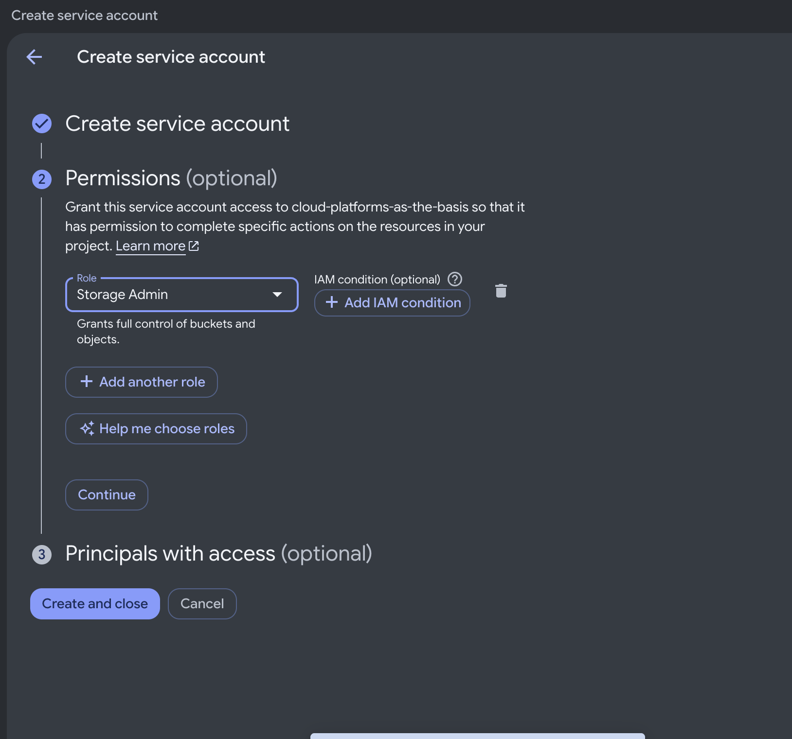

### 2. Создание виртуальной машины

В Compute Engine создана виртуальная машина со следующими параметрами:

| Параметр | Значение |
|---|---|
| Имя | `apushnaya-vm-lab1` |
| Регион и зона | `us-central1`, `us-central1-c` |
| Тип машины | `e2-micro` |
| Модель предоставления | `Spot` |
| ОС | Debian GNU/Linux 13 |
| Сервисный аккаунт | `apushnaya-sa-lab1` |
| Access scopes | `Allow full access to all Cloud APIs` |

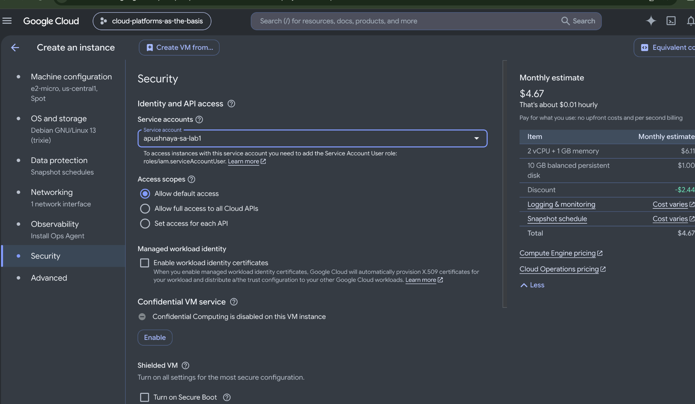

После создания VM получила статус Running.

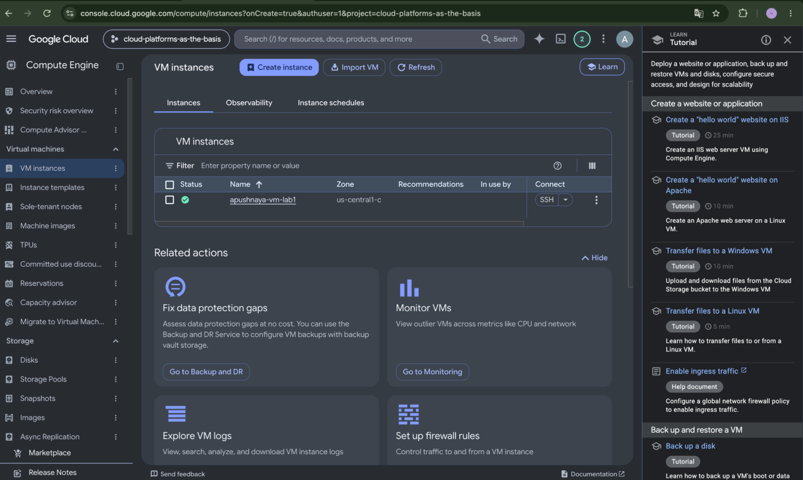

### 3. Копирование файлов из Cloud Storage

К VM выполнено подключение через SSH. Проверен активный аккаунт и содержимое бакета:

```bash
gcloud auth list
gcloud storage ls gs://lab1-bucket-itmo/
```

Активным оказался `apushnaya-sa-lab1@cloud-platforms-as-the-basis.iam.gserviceaccount.com`. В бакете находились `pic1.jpg`, `pic2.jpg`, `pic3.jpeg`.

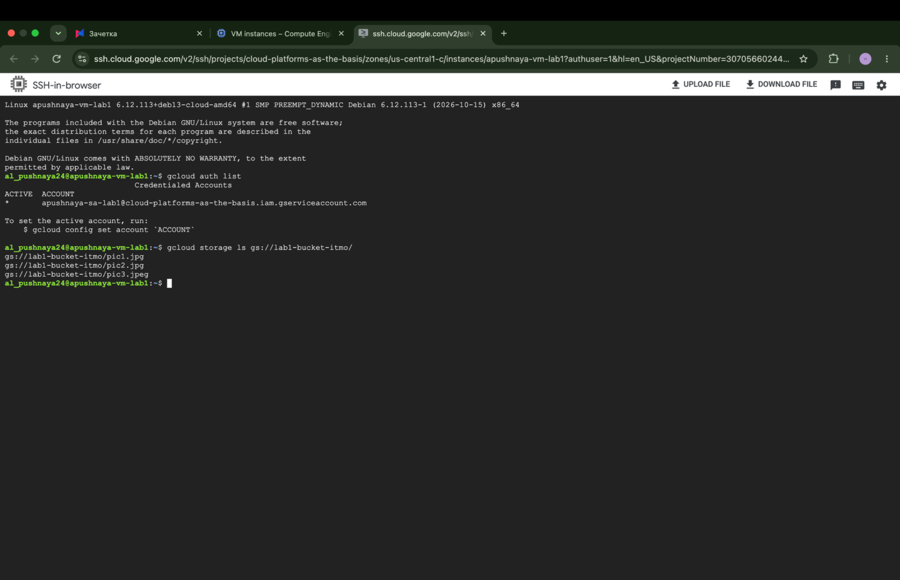

Файлы скопированы на VM:

```bash
mkdir -p ~/lab1-files
gcloud storage cp gs://lab1-bucket-itmo/* ~/lab1-files/
ls -lah ~/lab1-files/
```

Команда копирования завершилась успешно: `Completed files 3/3`. Команда `ls -lah` подтвердила наличие всех трёх файлов: `pic1.jpg` (228 КБ), `pic2.jpg` (487 КБ), `pic3.jpeg` (858 КБ).

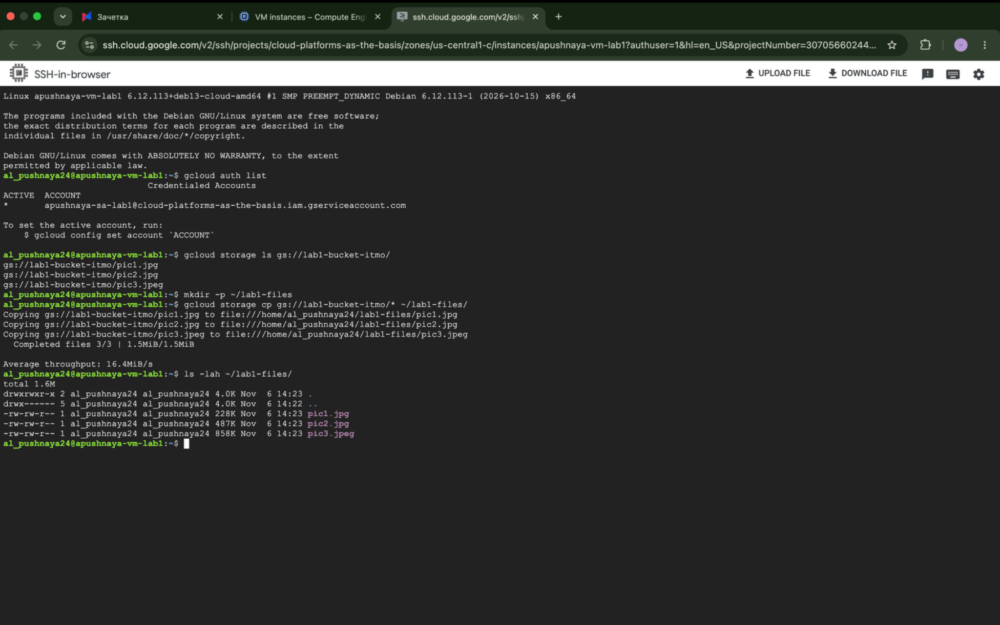

### 4. Изменение роли и повторная проверка

В IAM у сервисного аккаунта `apushnaya-sa-lab1` роль `Storage Admin` заменена на `Compute Viewer`.

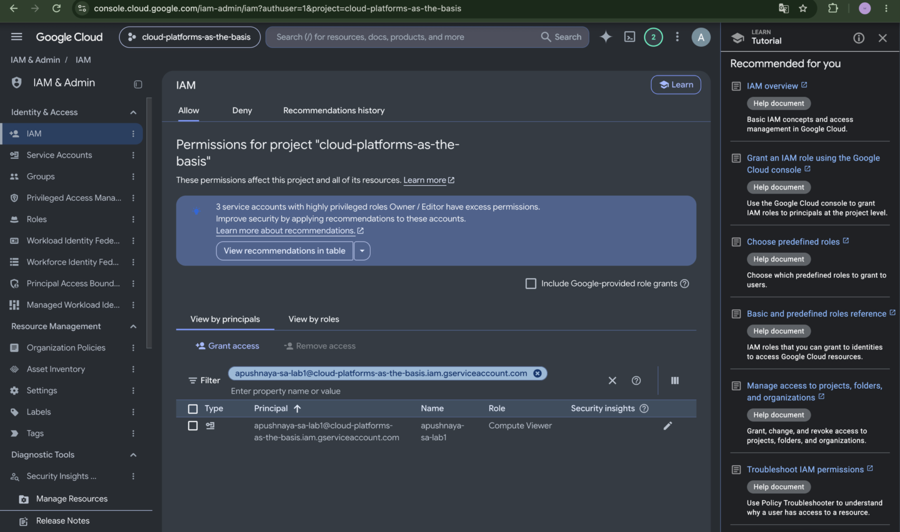

Повторное копирование выполнено в новую папку:

```bash
mkdir -p ~/lab1-retry
gcloud storage cp gs://lab1-bucket-itmo/* ~/lab1-retry/
```

Несмотря на смену роли, копирование снова завершилось успешно: `Completed files 3/3`. Список объектов бакета также продолжал отображаться.

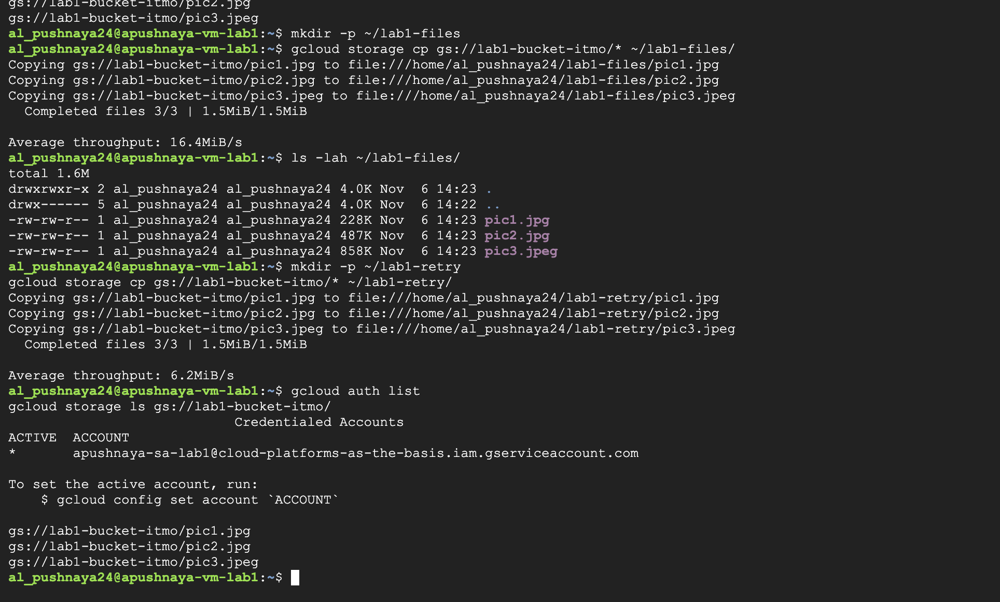

Для проверки прав на уровне бакета выполнена команда:

```bash
gcloud storage buckets get-iam-policy gs://lab1-bucket-itmo
```

Получена ошибка доступа: отсутствует разрешение `storage.buckets.getIamPolicy`.

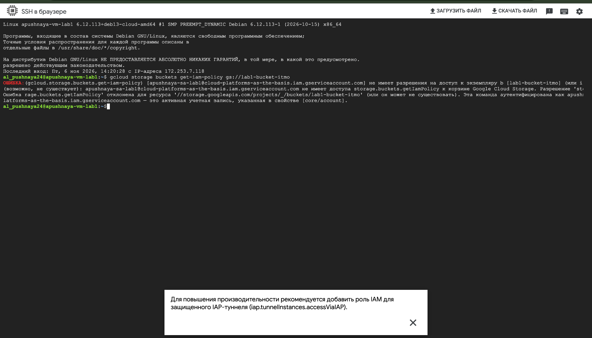

Дополнительно проверен доступ к одному из файлов без авторизации `gcloud`:

```bash
curl -sS -o /dev/null -w "HTTP status: %{http_code}\n" \
  "https://storage.googleapis.com/lab1-bucket-itmo/pic1.jpg"
```

Получен ответ `HTTP status: 200`. Это подтверждает доступность `pic1.jpg` по публичному HTTP-адресу. Точные разрешения, позволившие `gcloud` повторно получить список объектов и скачать все файлы, определить не удалось.

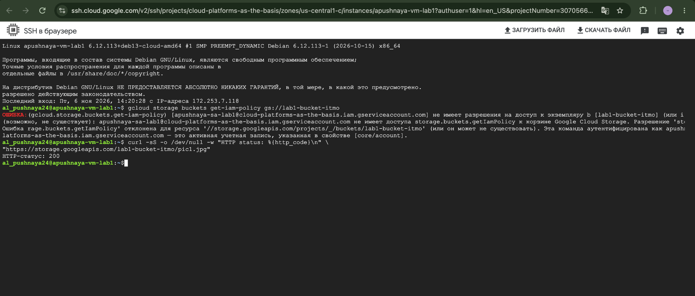

### 5. Удаление ресурсов

По окончании работы удалена виртуальная машина `apushnaya-vm-lab1` вместе с загрузочным диском. Затем удалён сервисный аккаунт `apushnaya-sa-lab1`. Учебный бакет не изменялся.

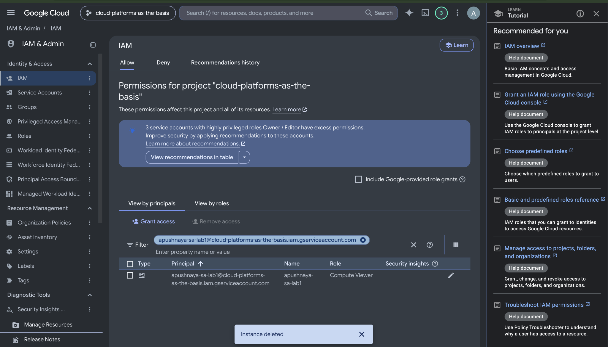

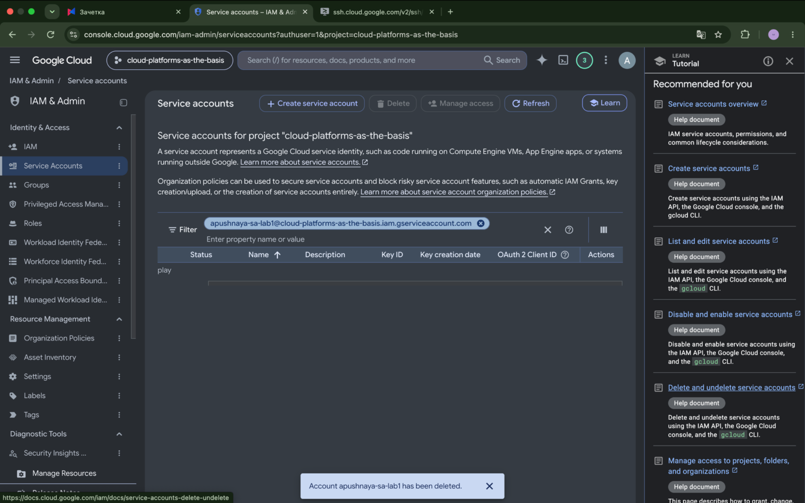

## Вывод

В ходе работы создан сервисный аккаунт с ролью `Storage Admin` и виртуальная машина `e2-micro` в режиме Spot. С помощью `gcloud` три файла скачаны из Cloud Storage на VM.

После изменения роли на `Compute Viewer` повторное скачивание также прошло успешно. Дополнительная проверка показала публичную доступность файла `pic1.jpg`, однако просмотреть IAM-политику бакета не удалось. Таким образом, смена роли на уровне проекта не привела к запрету доступа к файлам в данном эксперименте. После проверки созданные ресурсы удалены.
