[lab2_report.md](https://github.com/user-attachments/files/34489217/lab2_report.md)
# Лабораторная работа №2. Исследование Cloud Run

## Цель работы

Ознакомиться с работой Cloud Run, изучить логи, метрики и переключение трафика между ревизиями сервиса.

## Ход работы

### 1. Создание Cloud Run

В проекте `cloud-platforms-as-the-basis` создан сервис Cloud Run `apushnaya-run-lab2` на основе стандартного контейнера Hello.

| Параметр | Значение |
|---|---|
| Регион | `europe-west1` |
| Образ | `us-docker.pkg.dev/cloudrun/container/hello` |
| Порт контейнера | `8080` |
| CPU | 1 vCPU |
| Память | 512 MiB |
| Тип оплаты | Request-based |
| Масштабирование | Automatic |
| Минимальное число экземпляров | 0 |
| Начальное максимальное число экземпляров | 1 |

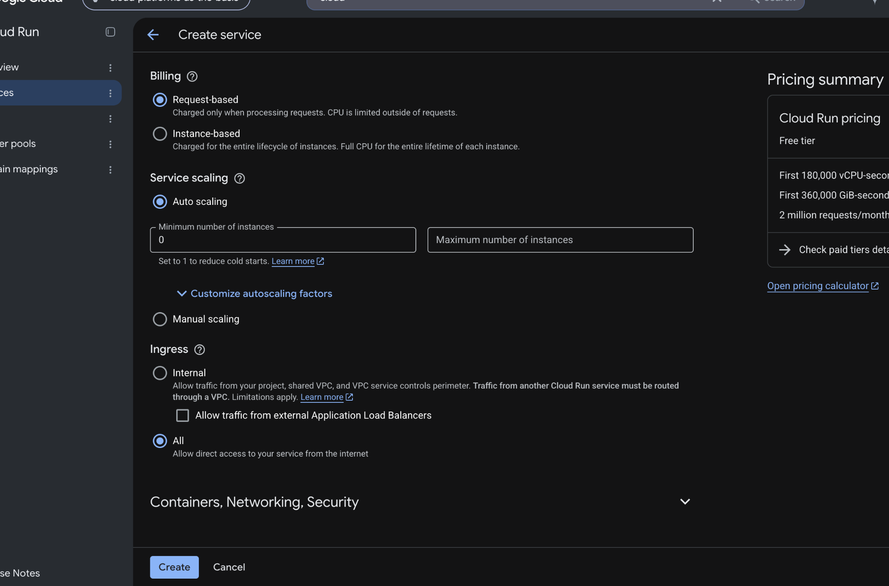

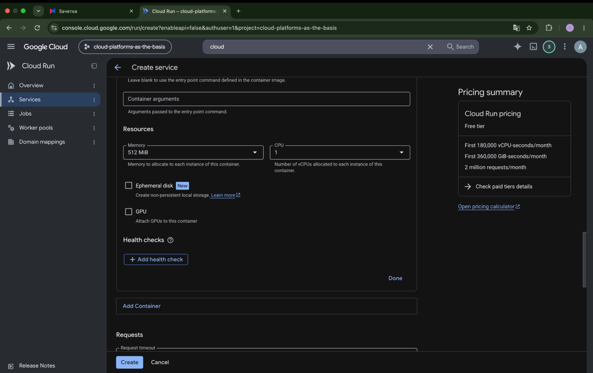

Сервис успешно развернулся. Создана первая ревизия `apushnaya-run-lab2-00001-w7s`, на которую поступало 100% трафика.

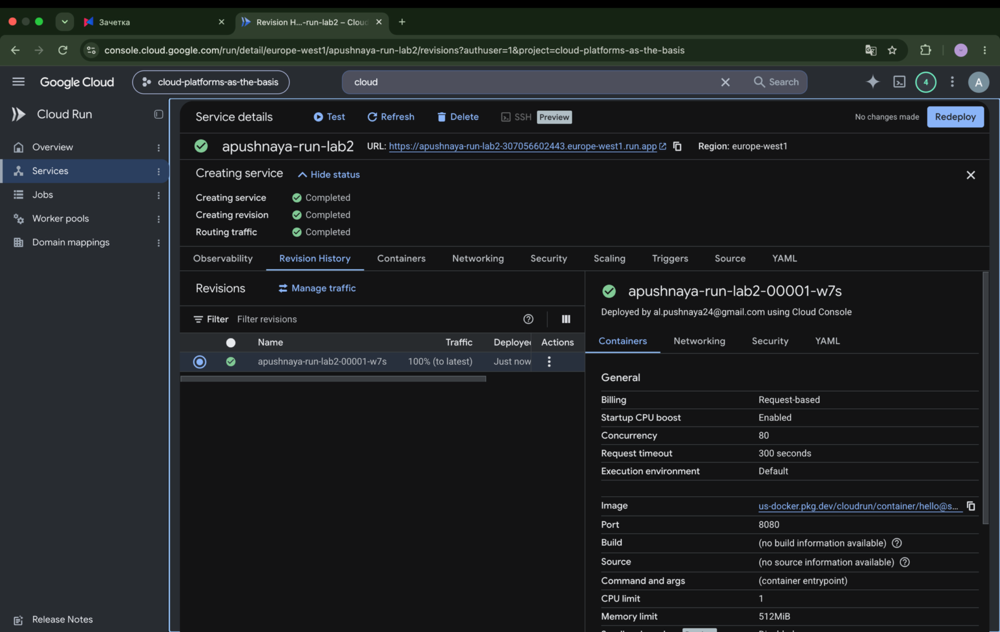

Проверена работа сервиса по выданному Cloud Run URL. Страница Hello открылась.

### 2. Анализ логов и метрик

В разделе **Observability → Logs** просмотрены события запуска контейнера и обращения к сервису. Проверка `STARTUP TCP probe` прошла успешно на порту `8080`. HTTP-запросы `GET` возвращали статус `200`. В логах отображались задержки 4, 17, 11 и 19 мс.

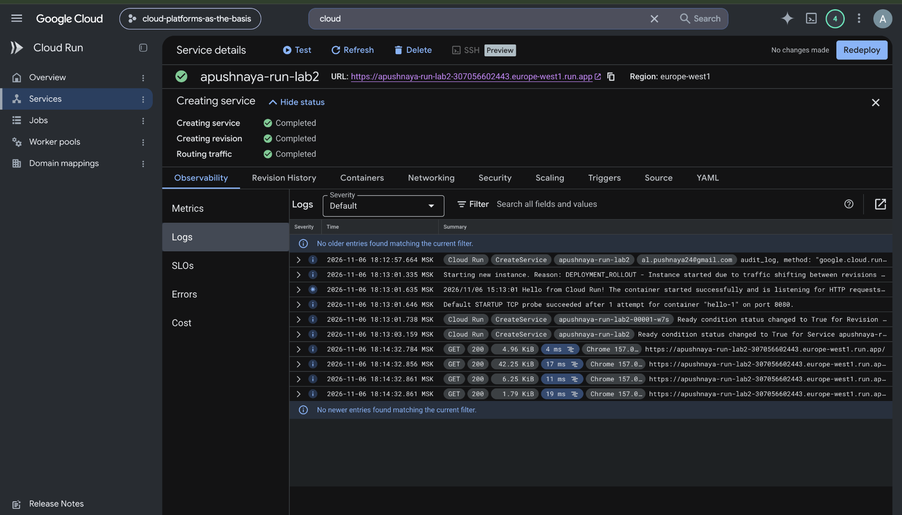

В разделе **Observability → Metrics** проверены графики количества запросов и времени ответа. На графиках были видны обращения к сервису и задержки обработки запросов.

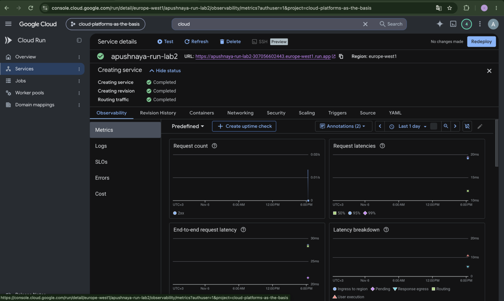

### 3. Изменение порта

Во вкладке **Containers** порт контейнера изменён с `8080` на `8090`. Остальные основные настройки контейнера оставлены без изменений.

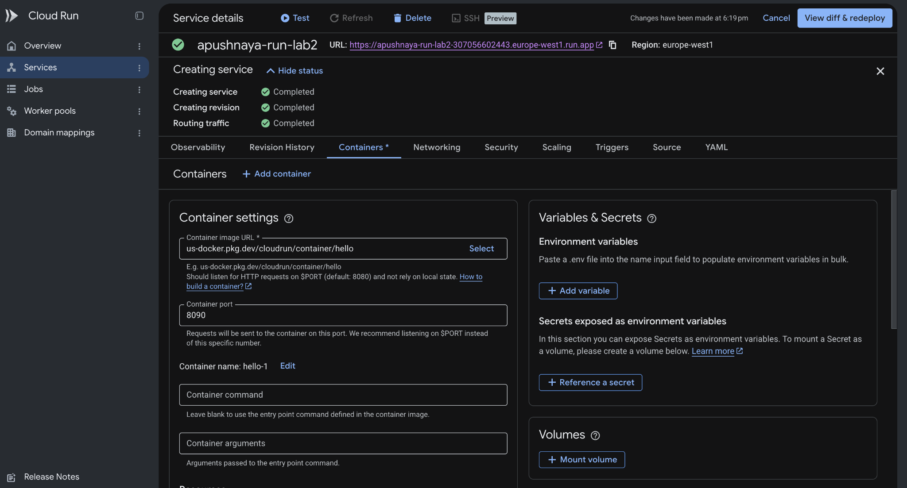

После повторного развёртывания создана ревизия `apushnaya-run-lab2-00002-xhx`. Сервис продолжил открываться по прежнему URL. На странице Hello отобразилось имя новой ревизии.

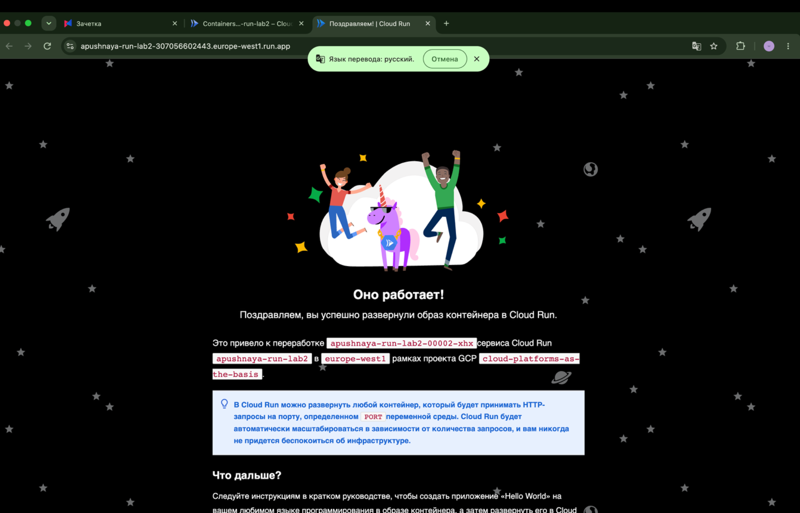

Контейнер Hello использует переменную окружения `PORT`, которую задаёт Cloud Run, поэтому изменение порта не привело к ошибке запуска.

### 4. Переключение трафика между ревизиями

Сначала выполнена попытка распределить трафик между двумя ревизиями при максимальном числе экземпляров, равном 1. Cloud Run вернул ошибку: `service level max instances must be greater than or equal to the number of targets receiving traffic`.

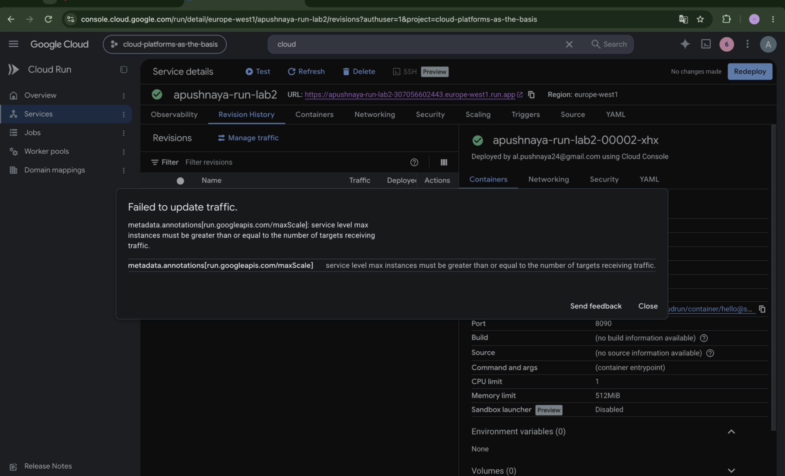

После увеличения максимального числа экземпляров до 2 удалось установить распределение трафика между ревизиями:

| Ревизия | Порт | Трафик |
|---|---|---|
| `00001-w7s` | 8080 | 50% |
| `00002-xhx` | 8090 | 50% |

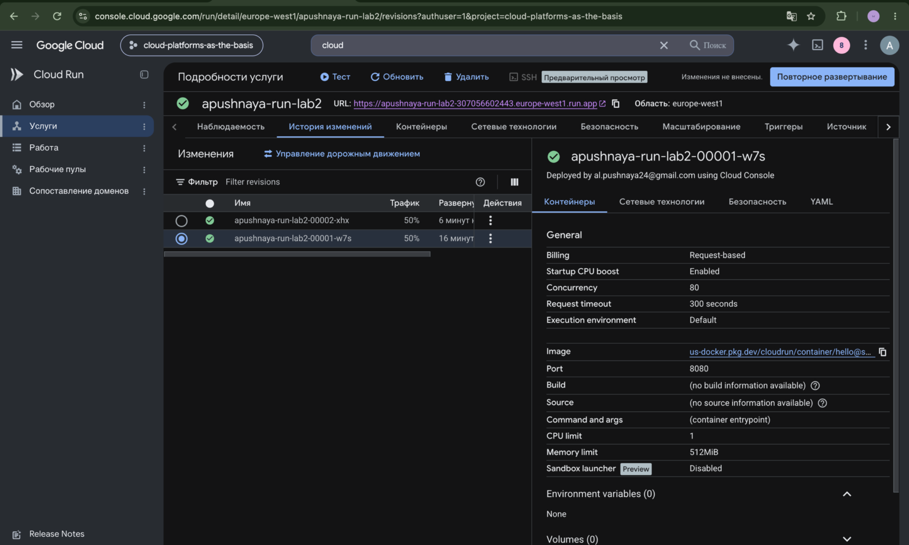

Далее трафик последовательно переключён полностью на первую и на вторую ревизии.

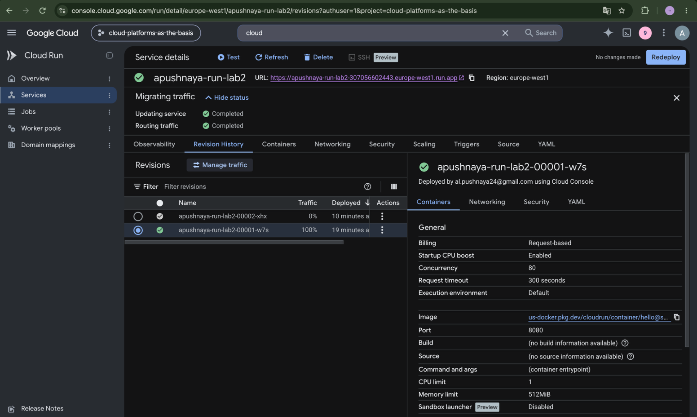

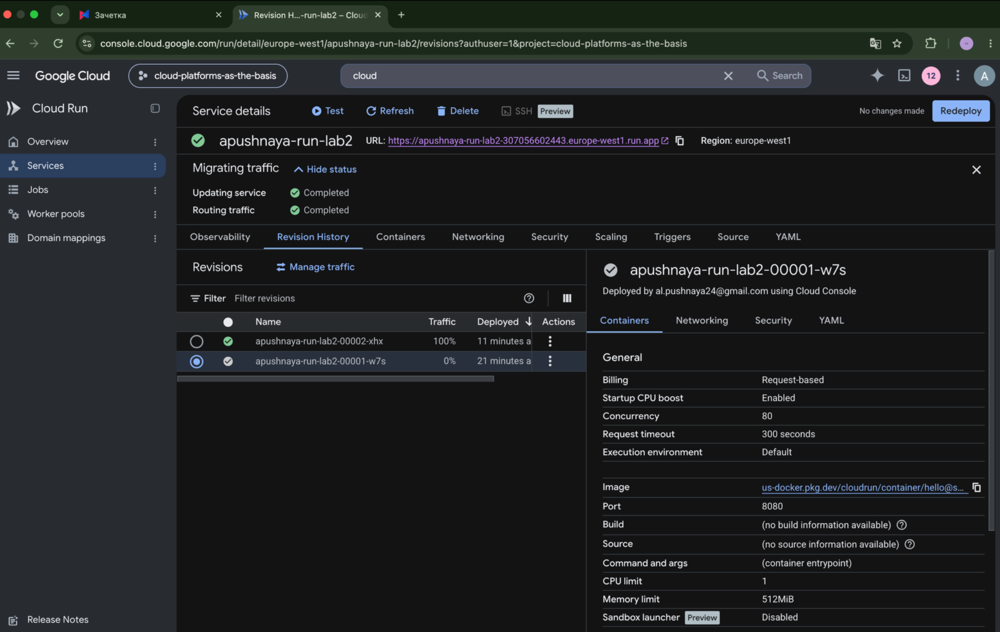

Обе ревизии находились в рабочем состоянии. При переключении трафика URL сервиса не менялся.

### 5. Удаление сервиса

После завершения эксперимента удалён сервис `apushnaya-run-lab2`. В Cloud Run → Services список стал пустым; консоль показала сообщение об успешном удалении.

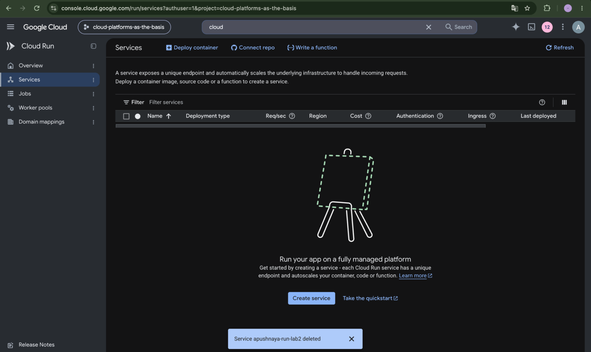

## Вывод

В ходе работы развернут стандартный Hello-контейнер в Cloud Run. Проверены запуск сервиса, HTTP-запросы, логи и метрики. После смены порта с `8080` на `8090` была создана новая ревизия, при этом сервис продолжил работать. Выполнено распределение трафика 50/50 и переключение 100% трафика между двумя ревизиями. По окончании работы сервис удалён.
