[lab3_report.md](https://github.com/user-attachments/files/34582731/lab3_report.md)

# Лабораторная работа №3. Исследование Cloud Storage

## Цель работы

Изучить работу Google Cloud Storage: создание бакета, загрузку и перемещение файлов, настройку публичного доступа.

## Ход работы

### 1. Создание бакета

В проекте `cloud-platforms-as-the-basis` создан бакет `apushnaya-lab3-307056602443`.

| Параметр | Значение |
|---|---|
| Расположение | `europe-west1` (Бельгия) |
| Класс хранения | `Standard` |
| Access control | `Uniform` |
| Public access prevention | Не включено |
| Шифрование | Google-managed encryption key |

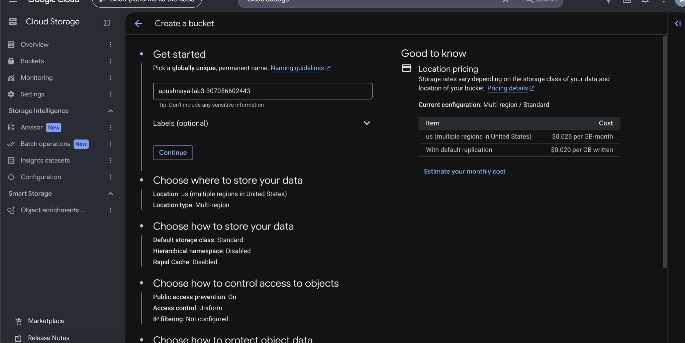

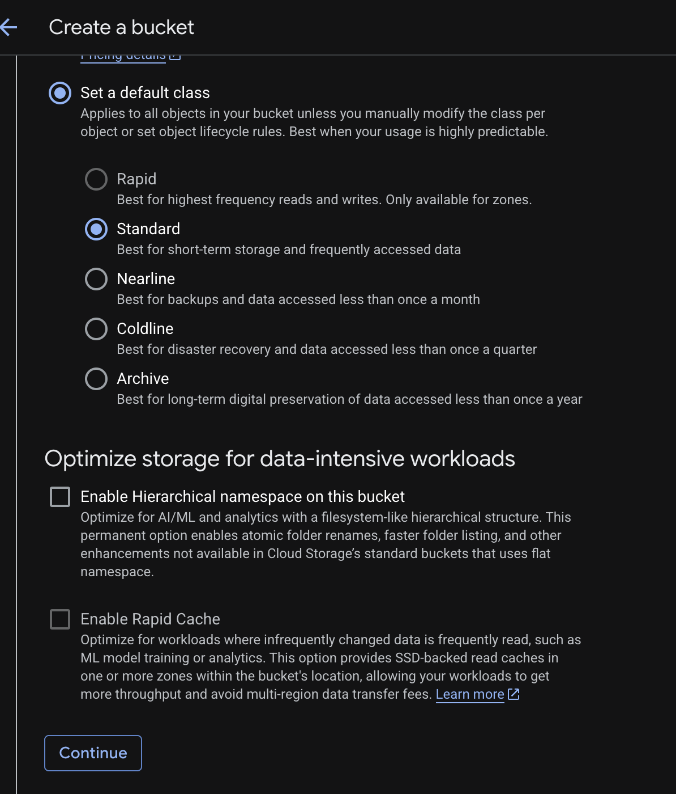

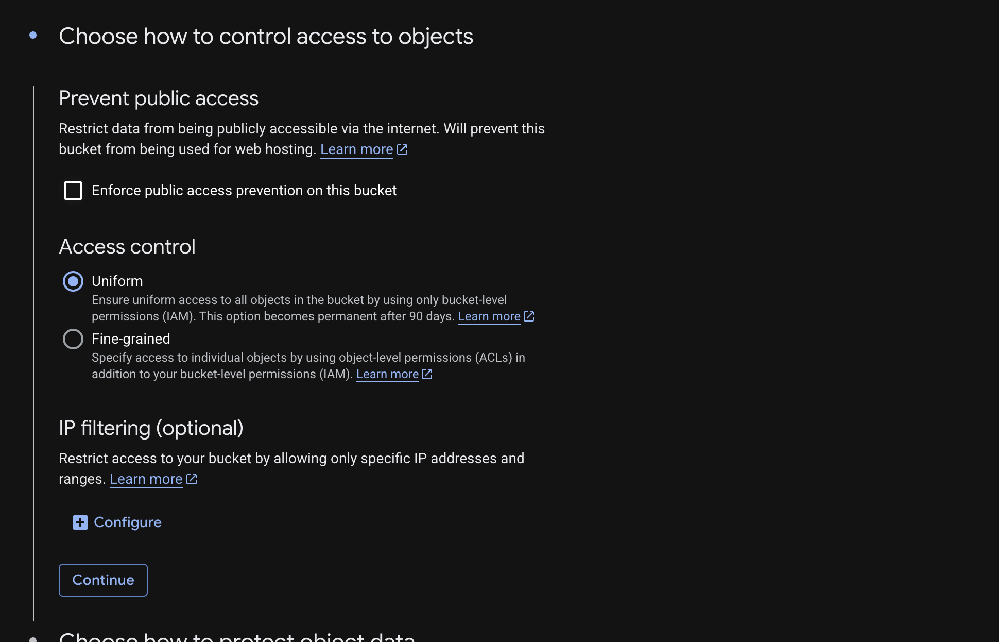

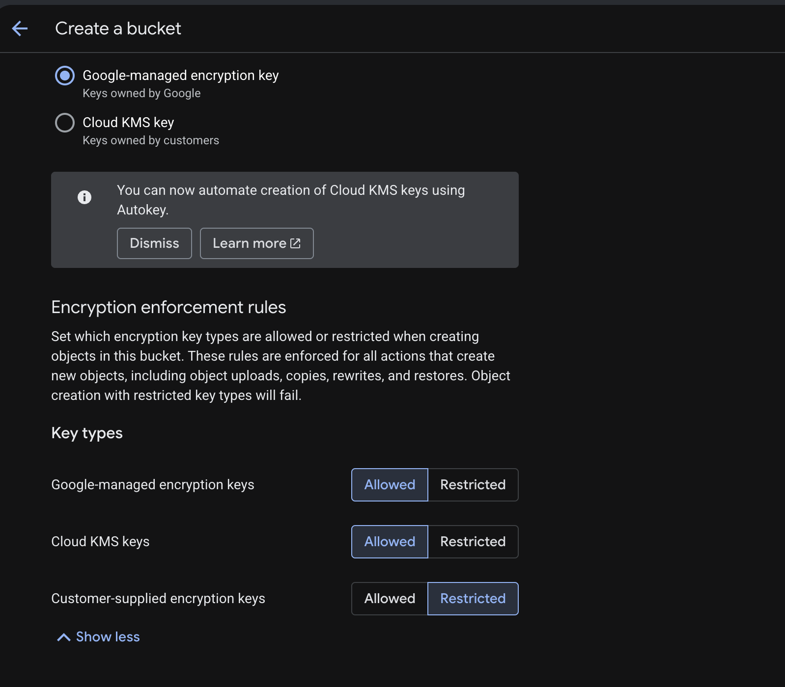

Бакет успешно создан. Изначально он имел статус `Not public`.

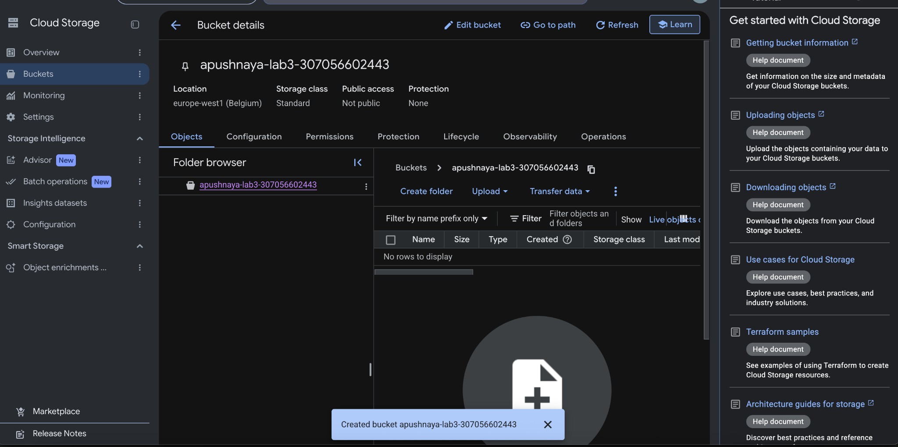

### 2. Загрузка и перемещение файлов

В корень бакета загружены три JPG-изображения размером 124,6 КБ, 57,3 КБ и 125,1 КБ. Консоль показала сообщение `3 files successfully uploaded`.

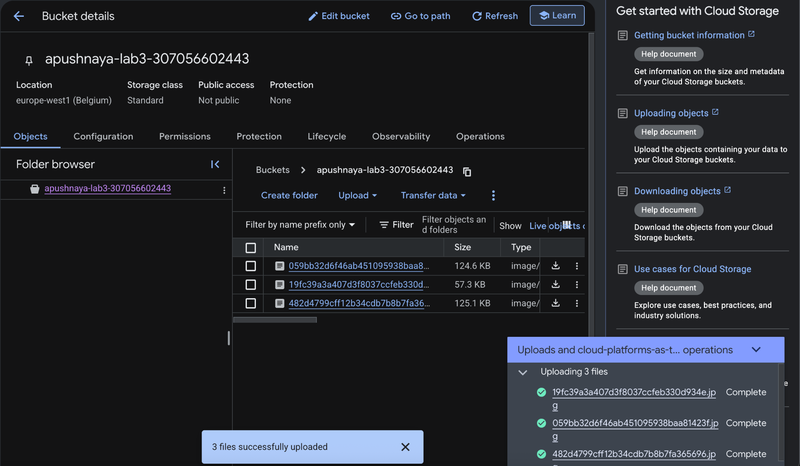

После загрузки создана папка `images/`. Все три файла перемещены в эту папку внутри того же бакета.

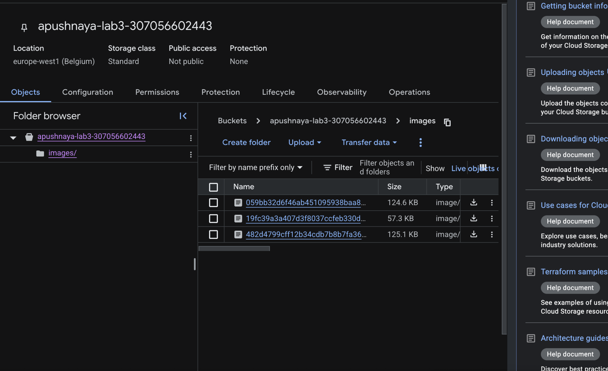

### 3. Настройка публичного доступа

Во вкладке **Permissions** настроен публичный доступ к объектам бакета. После сохранения политики появился статус `Access granted to public principals`.

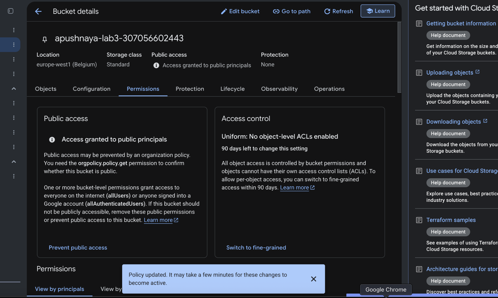

Через контекстное меню объектов скопированы публичные URL. Два изображения проверены в режиме инкогнито: они открылись без входа в Google-аккаунт. Таким образом, публичный доступ работал.

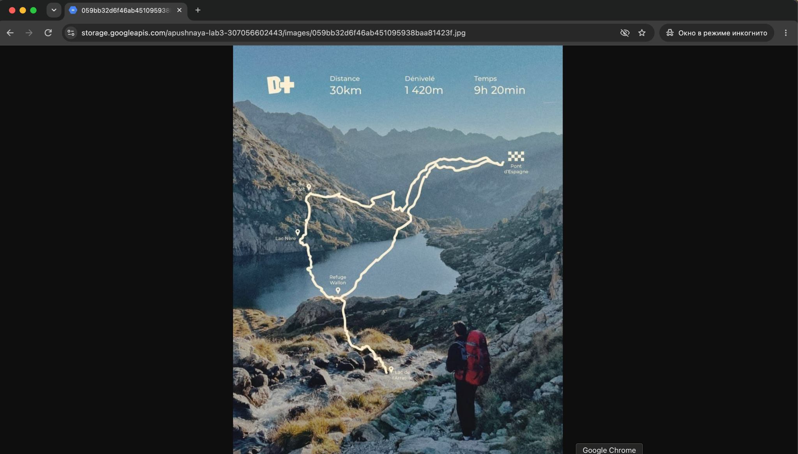

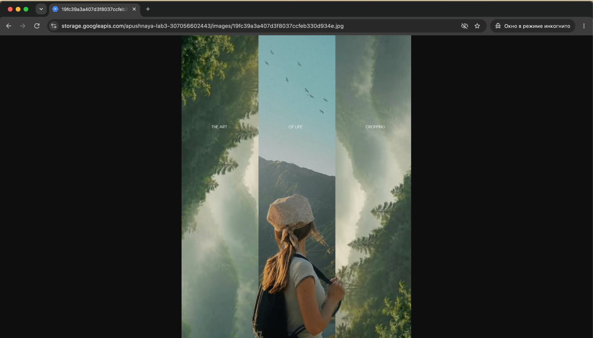

### 4. Удаление бакета

После проверки публичных ссылок удалён бакет `apushnaya-lab3-307056602443`. В списке остался только учебный бакет `lab1-bucket-itmo`. Консоль показала сообщение `Deleted 1 bucket`.

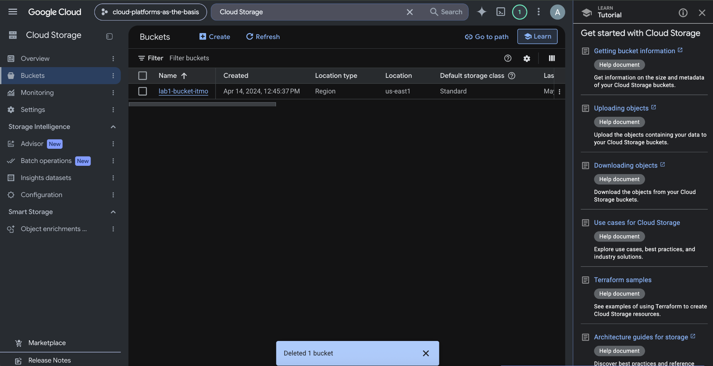

## Вывод

В ходе работы создан бакет Google Cloud Storage, в него загружены три изображения, затем файлы перемещены в папку `images/`. Настроен публичный доступ, а ссылки проверены в режиме инкогнито. После завершения работы бакет удалён. На практике изучена работа объектного хранилища и управление доступом к его содержимому.
