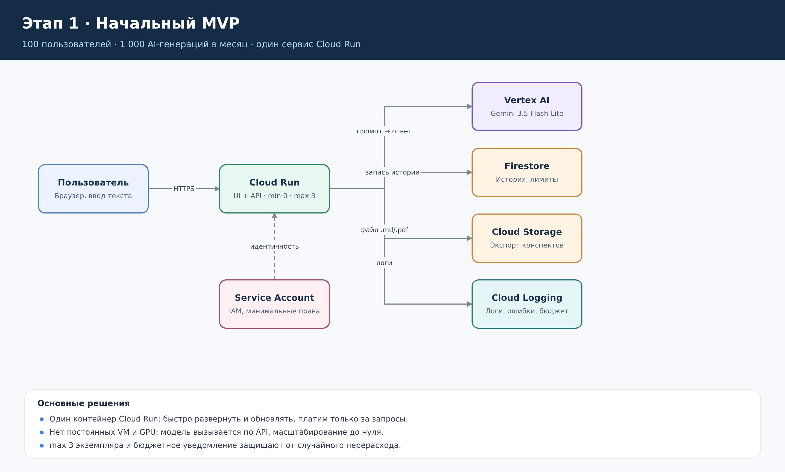
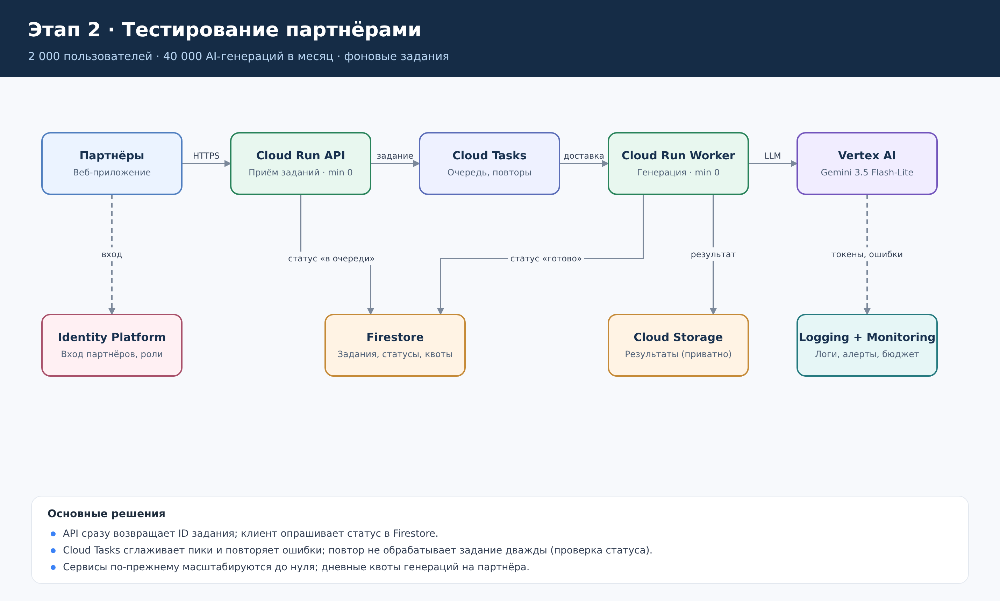
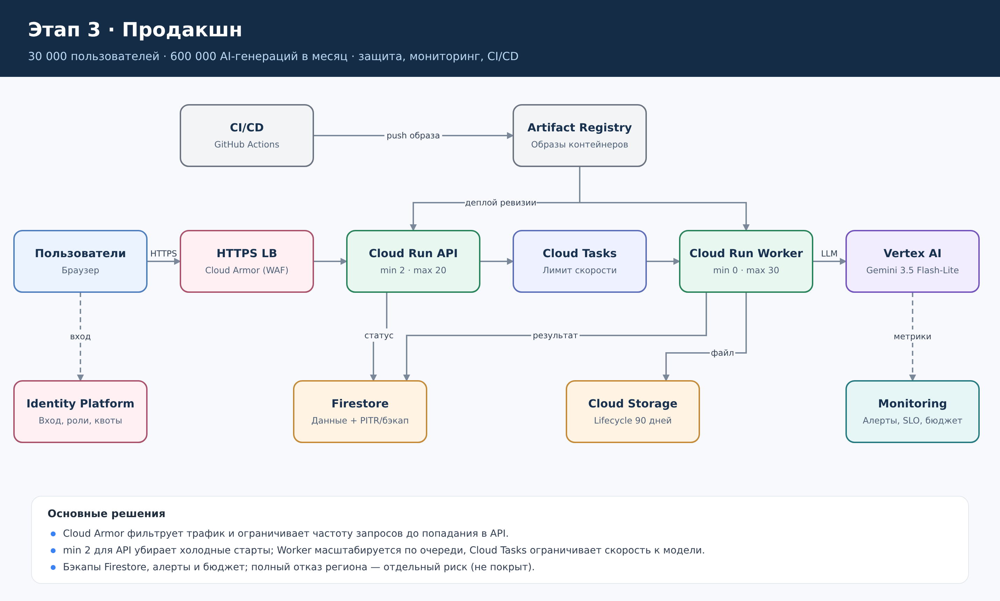

[lab4_report.md](https://github.com/user-attachments/files/34584491/lab4_report.md)

Course: [Облачные платформы как основа технологического предпринимательства](https://ex-itmo-ict-faculty.github.io/cloud-platforms-as-the-basis-of-technology-entrepreneurship/) 
Author: Пушная Алина

# Лабораторная работа №4. Разработка инфраструктуры MVP AI-приложения

## Цель работы

Создать прототип AI-приложения с базовой функциональностью: спроектировать его инфраструктуру для трех стадий развития (начальный MVP, тестирование партнерами, продакшн), рассчитать экономическую модель (ежемесячные расходы на содержание) и обосновать выбор облачных ресурсов.

## 1. Исходные данные

Для проектирования выбрано приложение **StudyBrief** — AI-помощник для студентов. Пользователь вставляет учебный текст и получает краткий конспект и пять вопросов для самопроверки. Результат можно сохранить и скачать.

По условию лабораторной облачные ресурсы не создавались; нагрузки ниже — расчетные допущения.

| Показатель | Начальный MVP | Тестирование партнёрами | Продакшн |
|---|---:|---:|---:|
| Активных пользователей в месяц (MAU) | 100 | 2 000 | 30 000 |
| Генераций AI в месяц | 1 000 | 40 000 | 600 000 |
| Генераций в сутки (в среднем) | ~33 | ~1 333 | 20 000 |
| Пиковая нагрузка (15 % суточных генераций за час) | ~0,001 запр./с | ~0,06 запр./с | ~0,8 запр./с |
| Объём файлов в Cloud Storage | 5 GiB | 100 GiB | 1 000 GiB |
| Данные Firestore | 0,5 GiB | 2 GiB | 25 GiB |
| Минимум экземпляров API | 0 | 0 | 2 |

При времени обработки ~4 с даже пик продакшна (~0,8 запр./с) — это около 3–4 одновременных генераций; всплеск ×5 — около 17. Поэтому для Worker задан предел `max 30` экземпляров, а не постоянный кластер.

**Параметры одной генерации:** 1 500 входных и 400 выходных токенов. Чтобы допущение по выходу выполнялось, в запросе к модели задаются `max_output_tokens = 512` и минимальный уровень рассуждений (thinking), а длина входного текста ограничивается в API.

**Модель:** **Gemini 3.5 Flash-Lite** через Vertex AI. Задача (конспект + вопросы по присланному тексту) не требует «тяжёлой» модели, а Flash-Lite — самый дешёвый класс моделей Gemini. Прежний выбор, Gemini 2.5 Flash, не подходит: семейство Gemini 2.5 выведено из эксплуатации в Vertex AI 20.10.2026. Перед запуском нужно проверить дату вывода выбранной модели на странице [Model versions](https://cloud.google.com/vertex-ai/generative-ai/docs/learn/model-versions) и закрепить версию модели в конфигурации.

Регион основных ресурсов — Европа (`europe-west1`). OCR, поиск по большой базе документов и дообучение модели в MVP не входят.

## 2. Схемы инфраструктуры

Редактируемый файл со всеми тремя схемами (3 страницы): [`lab4_infrastructure.drawio`](lab4_infrastructure.drawio), открывается на [app.diagrams.net](https://app.diagrams.net/). Изображения ниже построены по той же схеме.

### 2.1. Начальный MVP

**Как работает:** пользователь вводит текст в браузере → Cloud Run принимает запрос → вызывает Gemini через Vertex AI → сохраняет историю в Firestore, а экспорт результата — в Cloud Storage. Логи и ошибки пишутся в Cloud Logging. Сервис работает от отдельного Service Account с минимальными правами (без JSON-ключей).

**Выбор:** один контейнер Cloud Run с масштабированием от **0 до 3 экземпляров**. Нет постоянной VM и собственного GPU: при 1 000 генераций в месяц сервис почти всё время простаивает, а Cloud Run в простое не тарифицируется. Ограничение `max 3` и бюджетное уведомление защищают от случайного перерасхода.

### 2.2. Тестирование партнёрами

**Что меняется:**

- Вход партнёров через **Identity Platform** (роли, токены). API проверяет токен и дневную квоту генераций партнёра.
- Генерация выносится в отдельный **Cloud Run Worker** через очередь **Cloud Tasks**. API записывает задание в Firestore со статусом «в очереди» и сразу возвращает его ID; Worker выполняет генерацию, сохраняет файл в Cloud Storage и меняет статус на «готово».
- Добавляются Cloud Monitoring и алерты по ошибкам и расходу токенов.

**Выбор:** очередь сглаживает пики и автоматически повторяет неудачные задания. Перед обработкой Worker проверяет статус задания, поэтому повтор не обрабатывает его дважды. Оба сервиса по-прежнему масштабируются до нуля.

### 2.3. Продакшн

**Что меняется:**

- Перед API ставятся **HTTPS Load Balancer** и **Cloud Armor** (WAF, ограничение частоты запросов).
- У Cloud Run API **2 минимальных экземпляра** против холодных стартов; Worker масштабируется по очереди (`min 0 / max 30`), а Cloud Tasks ограничивает скорость обращений к модели в пределах квоты Vertex AI.
- Для Firestore включаются восстановление на момент времени (PITR) и регулярные бэкапы; для Cloud Storage — правило жизненного цикла (удаление экспортов старше 90 дней).
- **CI/CD:** GitHub Actions собирает образ → Artifact Registry → деплой новой ревизии API и Worker.
- Monitoring: алерты, SLO и бюджетные уведомления.

Решение устойчиво к сбою отдельных экземпляров и зон, но **не обеспечивает автоматического восстановления при отказе всего региона**. Межрегиональное резервирование — отдельный этап с дополнительным бюджетом.

## 3. Обоснование сервисов

| Сервис | Для чего используется | Почему выбран | Этапы |
|---|---|---|---|
| Cloud Run | UI, API и Worker | Автомасштабирование, в т. ч. до нуля; не нужно администрировать VM | 1–3 |
| Vertex AI + Gemini 3.5 Flash-Lite | Генерация конспектов и вопросов | Готовая модель по API, оплата за токены, не нужен свой GPU | 1–3 |
| Firestore | История, задания, статусы, квоты | Serverless-БД, бесплатная квота покрывает этапы 1–2 | 1–3 |
| Cloud Storage Standard | Экспортированные файлы | Объектное хранилище, приватный доступ по подписанным ссылкам | 1–3 |
| IAM / Service Accounts | Доступ сервисов друг к другу | Минимальные права, без постоянных ключей | 1–3 |
| Cloud Logging / Monitoring | Логи, метрики, алерты, бюджет | Быстрый поиск ошибок, контроль расходов на токены | 1–3 |
| Identity Platform | Вход пользователей и партнёров | Готовая авторизация; бесплатно до 50 000 MAU | 2–3 |
| Cloud Tasks | Очередь заданий | Повторы при ошибках, ограничение скорости к модели | 2–3 |
| HTTPS LB + Cloud Armor | Публичная точка входа | WAF, rate limiting, защита от ботов | 3 |
| Artifact Registry + CI/CD | Сборка и выкладка контейнеров | Воспроизводимый деплой, быстрый откат ревизий | 3 |

### 3.1. Почему не самое дешёвое решение на первом этапе

На первом этапе можно было бы обойтись бесплатной VM (e2-micro) со всем приложением на ней. Это почти не дешевле — Cloud Run с нулём экземпляров здесь и так укладывается в бесплатную квоту, — но при росте пришлось бы переносить приложение: настраивать масштабирование, балансировщик, отказоустойчивость, обновления ОС. Выбранная связка **Cloud Run + Firestore + Cloud Storage + Vertex AI** не меняется между этапами, к ней только **добавляются** компоненты (очередь, авторизация, LB, CI/CD). Поэтому переход между стадиями не требует переписывания.

| Альтернатива | Плюсы | Почему не выбрана |
|---|---|---|
| Одна VM (Compute Engine) | Простая модель, фиксированная цена | Нет масштабирования до нуля и автомасштабирования, ручное администрирование, миграция при росте |
| GKE (Kubernetes) | Гибкость, выгоден при стабильно высокой нагрузке | Избыточен для 1–3 сервисов, плата за кластер и сложность сопровождения |
| Своя open-source модель на GPU | Контроль над моделью и данными | GPU-инстанс оплачивается 24/7 — ориентировочно сотни долларов в месяц даже на этапе MVP, нужен MLOps |
| Более мощная модель (Gemini 3.8 Flash) | Выше качество ответов | В 3,6 раза дороже за генерацию (см. п. 4.4), для конспектов избыточна |

Пересмотреть выбор (например, перейти на GKE или Committed Use Discounts) имеет смысл, когда нагрузка станет стабильно высокой и предсказуемой.

## 4. Экономическая модель

Расчёт выполнен **на 30 дней**, в USD, без налогов, по открытым тарифам Google Cloud на ноябрь 2026 г. Фактическая стоимость зависит от региона, длины запросов, логов, сети и пиков нагрузки.

### 4.1. Тарифы и допущения

- **Gemini 3.5 Flash-Lite (Vertex AI, Standard):** $0.30 за 1 млн входных токенов, $2.50 за 1 млн выходных (включая токены рассуждения) — [Vertex AI pricing](https://cloud.google.com/vertex-ai/generative-ai/pricing). Цена указана для глобальной точки доступа; региональная обработка может стоить примерно на 10 % дороже — это покрывается запасом 20 %.
- **Cloud Run (request-based, Tier 1, `europe-west1`):** CPU $0.000024 за vCPU-с, память $0.0000025 за GiB-с, запросы $0.40 за 1 млн. Бесплатно в месяц: 180 000 vCPU-с, 360 000 GiB-с, 2 млн запросов. Простаивающие минимальные экземпляры: $0.0000025 за vCPU-с и $0.0000025 за GiB-с — [Cloud Run pricing](https://cloud.google.com/run/pricing).
- **Cloud Storage Standard (регион):** ~$0.020 за GiB в месяц — [Cloud Storage pricing](https://cloud.google.com/storage/pricing).
- **Firestore Standard:** чтения $0.03 и записи $0.09 за 100 000 документов, хранение ~$0.15/GiB в месяц. Бесплатно: 50 000 чтений и 20 000 записей в сутки, 1 GiB хранения — [Firestore pricing](https://cloud.google.com/firestore/pricing).
- **Identity Platform:** бесплатно до 50 000 MAU (email и соцсети) — укладываемся на всех этапах.
- **Cloud Run:** конфигурация 1 vCPU / 512 MiB; **4 с оплачиваемого времени на генерацию** суммарно по API и Worker (ожидание ответа модели ~3 с + запись в Firestore и Storage); ~3 HTTP-запроса на генерацию (создание задания, доставка в Worker, проверка статуса). Реальные значения уточняются нагрузочным тестом.
- **Firestore:** 4 чтения и 2 записи на генерацию, нагрузка по дням равномерная, бесплатные лимиты не заняты другими проектами биллингового аккаунта.
- Сеть, логи, балансировщик, Cloud Armor, очередь и прочее заложены **оценками**, а не точным счётом.

### 4.2. Расчёт по статьям

**Стоимость одной генерации в модели:**

`(1 500 × $0.30 + 400 × $2.50) / 1 000 000 = $0.00145`

**Gemini за месяц:** MVP `1 000 × $0.00145 = $1.45`; партнёры `40 000 × $0.00145 = $58.00`; продакшн `600 000 × $0.00145 = $870.00`.

**Cloud Run:**

- MVP: `1 000 × 4 = 4 000` vCPU-с — в пределах бесплатной квоты → **$0**.
- Партнёры: `40 000 × 4 = 160 000` vCPU-с < 180 000; память `80 000` GiB-с < 360 000; запросов ~120 000 < 2 млн → **$0**.
- Продакшн:
  - CPU: `(600 000 × 4 − 180 000) × $0.000024 = $53.28`;
  - память: `(600 000 × 4 × 0.5 − 360 000) × $0.0000025 = $2.10`;
  - запросы: ~1,8 млн < 2 млн бесплатных → $0;
  - 2 минимальных экземпляра в простое: `2 × 30 × 86 400 × ($0.0000025 + 0.5 × $0.0000025) = $19.44`;
  - **итого $74.82** (консервативно: время простоя и обработки частично пересекаются).

**Firestore:**

- Партнёры: чтения 160 000 и записи 80 000 в месяц (~5 300 и ~2 700 в сутки) — в пределах бесплатных; хранение `(2 − 1) × $0.15 = $0.15`.
- Продакшн:
  - чтения: `(2 400 000 − 1 500 000) / 100 000 × $0.03 = $0.27`;
  - записи: `(1 200 000 − 600 000) / 100 000 × $0.09 = $0.54`;
  - хранение: `(25 − 1) × $0.15 = $3.60`;
  - **итого $4.41** (бэкапы/PITR и индексные чтения не включены — покрываются запасом).

**Cloud Storage:** `5 × $0.02 = $0.10`; `100 × $0.02 = $2.00`; `1 000 × $0.02 = $20.00`.

**HTTPS LB + Cloud Armor (оценка $70):** по прайсу базовая часть — около $30 в месяц (правило переадресации ~$18, политика и правила Cloud Armor ~$10, плата за ~1,8 млн запросов ~$1–2); остальное — запас на обработку трафика и дополнительные правила.

### 4.3. Сводная таблица расходов

| Статья, USD/мес. | Начальный MVP | Партнёры | Продакшн |
|---|---:|---:|---:|
| Gemini 3.5 Flash-Lite | $1.45 | $58.00 | $870.00 |
| Cloud Run | $0.00 | $0.00 | $74.82 |
| Cloud Storage | $0.10 | $2.00 | $20.00 |
| Firestore | $0.00 | $0.15 | $4.41 |
| Сеть и логи (оценка) | $2.00 | $10.00 | $40.00 |
| Load Balancer + Cloud Armor (оценка) | — | — | $70.00 |
| Cloud Tasks, Identity Platform, Artifact Registry, прочее (оценка) | $0.00 | $1.00 | $5.00 |
| **Базовая оценка** | **$3.55** | **$71.15** | **$1 084.23** |
| **С запасом 20 %** | **$4.26** | **$85.38** | **$1 301.08** |

**Юнит-экономика (с запасом 20 %):**

| Показатель | Начальный MVP | Партнёры | Продакшн |
|---|---:|---:|---:|
| Стоимость одной генерации | $0.0043 | $0.0021 | $0.0022 |
| Стоимость на активного пользователя в месяц | $0.043 | $0.043 | $0.043 |

На первых двух этапах инфраструктура почти бесплатна (scale-to-zero и бесплатные квоты), основная статья — обращения к модели. В продакшне добавляются расходы на защиту, доступность и мониторинг, но стоимость на пользователя остаётся около **$0.04 в месяц**. Значит, даже подписка за $1–2 в месяц или бесплатный тариф с лимитом генераций экономически оправданы. Расчёт **не включает** зарплаты, поддержку, налоги, межрегиональное резервирование и непредвиденный рост нагрузки.

### 4.4. Чувствительность модели

- **Запросы вдвое длиннее** (3 000 входных и 800 выходных токенов): Gemini в продакшне вырастет с $870 до $1 740, итог с запасом — до **~$2 345 в месяц**.
- **Более мощная модель** Gemini 3.8 Flash (с 01.01.2027 $1.50 / $7.50 за 1 млн токенов): `(1 500 × 1.50 + 400 × 7.50) / 10⁶ = $0.00525` за генерацию, $3 150 в месяц только на модель, итог с запасом — **~$4 037 в месяц**, в 3,1 раза больше.

Отсюда меры контроля: ограничение длины текста и `max_output_tokens`, квоты на пользователя, мониторинг расхода токенов, бюджетные уведомления, выбор самой лёгкой модели, которая даёт нужное качество. Для фоновых заданий можно рассмотреть Batch/Flex-режим Vertex AI (−50 % к цене модели) ценой большей задержки.

## 5. Риски и ограничения

| Риск | Что предусмотрено |
|---|---|
| Рост расходов на модель | Лимит длины текста и выходных токенов, квоты, мониторинг токенов, бюджетные уведомления |
| Вывод модели из эксплуатации | Версия модели вынесена в конфигурацию; дата вывода отслеживается, переход проверяется заранее |
| Пиковая нагрузка | Cloud Tasks, автомасштабирование Worker, `max instances`, rate limiting в Cloud Armor |
| Ошибки генерации | Повторы задач, статус ошибки, ограничение числа повторов, идемпотентность |
| Утечка пользовательских данных | Приватные бакеты, подписанные ссылки, Identity Platform, IAM с минимальными правами |
| Сбой региона | Бэкапы/PITR Firestore; межрегиональное восстановление — отдельный этап |
| Неверные ответы AI | Предупреждение пользователю, выборочная проверка качества, кнопка «сообщить об ошибке» |

## Вывод

Спроектирована инфраструктура AI-приложения StudyBrief для трёх стадий на serverless-сервисах Google Cloud: Cloud Run, Vertex AI (Gemini 3.5 Flash-Lite), Firestore и Cloud Storage. На этапе партнёрского тестирования добавляются очередь заданий и авторизация, в продакшне — балансировщик с Cloud Armor, минимальные экземпляры API, бэкапы, мониторинг и CI/CD. Базовая архитектура не меняется между стадиями, поэтому рост не требует миграции.

Месячный бюджет с запасом 20 % — **$4.26**, **$85.38** и **$1 301.08** соответственно, около $0.04 на активного пользователя. Основная переменная статья — обращения к AI-модели, поэтому главные рычаги экономии — выбор модели и контроль числа токенов.
